# VoStory

**Voice + Story** — 自用的 AI 有声小说 / 广播剧制作工具。

VoStory 不是简单的文本转语音工具，而是将长篇小说转化为可编辑、可返工的广播剧工程：角色合并去重、为角色自动设计固定的基础音色、按场景语境生成每句台词的语气，最终拼接导出。

## 功能预览

### 登录


### 工作空间管理

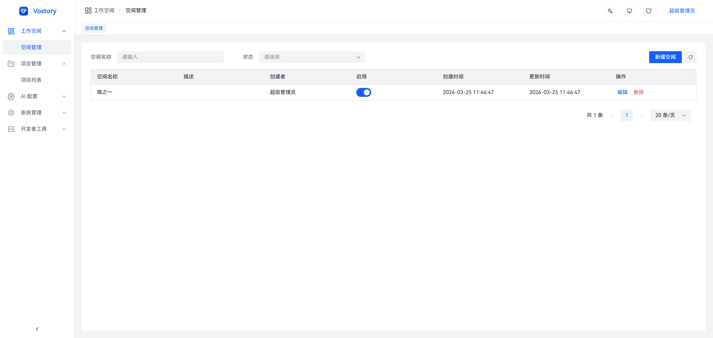

### 项目管理

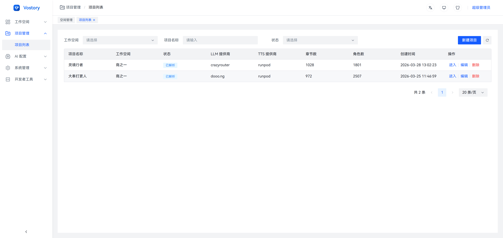

### 脚本编辑

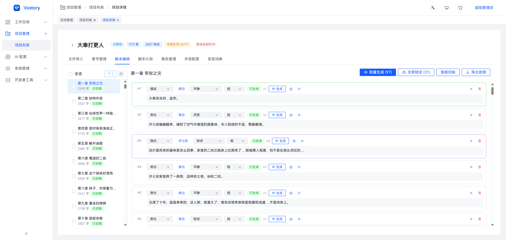

### 角色管理

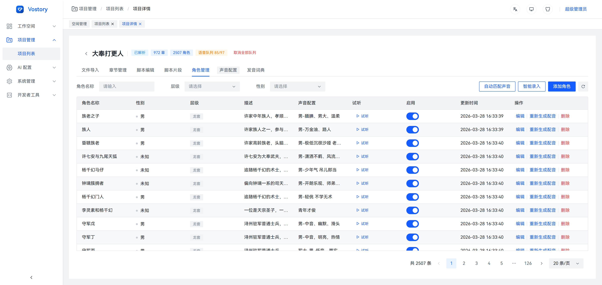

### 声音配置

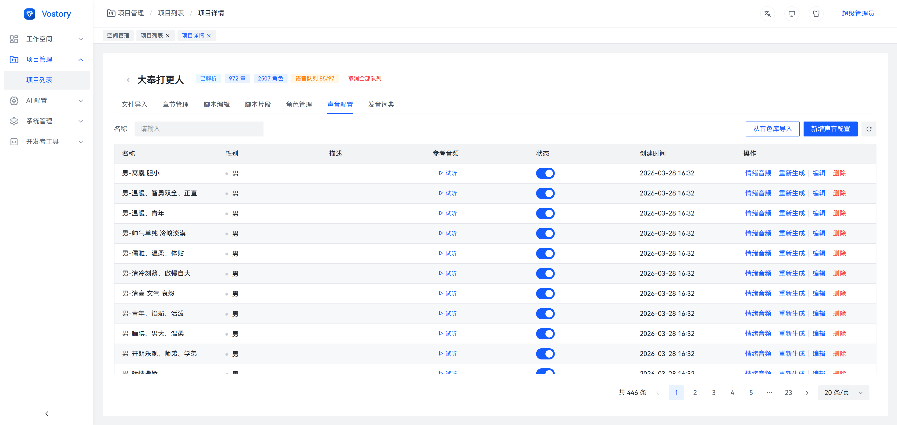

### 发音词典

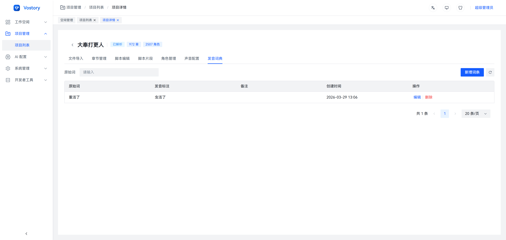

### AI 配置 — 音色管理

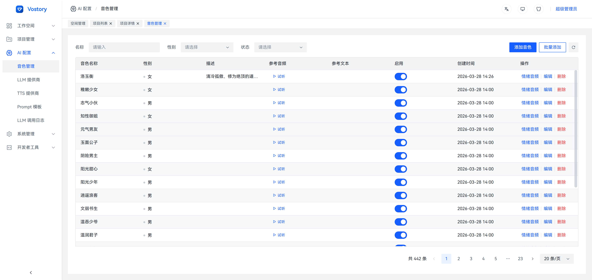

### AI 配置 — LLM 提供商

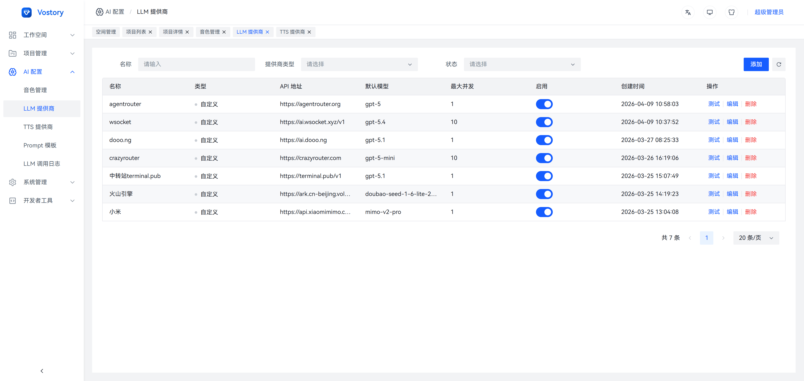

### AI 配置 — TTS 供应商

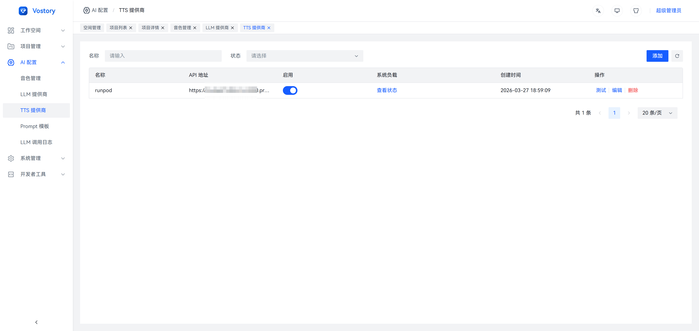

### AI 配置 — Prompt 模板

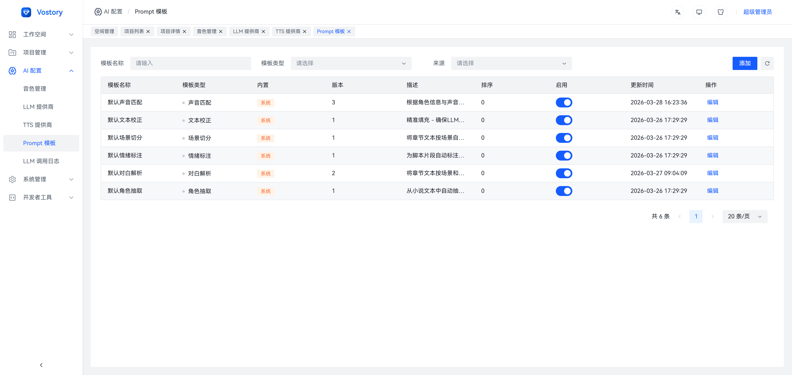

### AI 配置 — LLM 调用日志

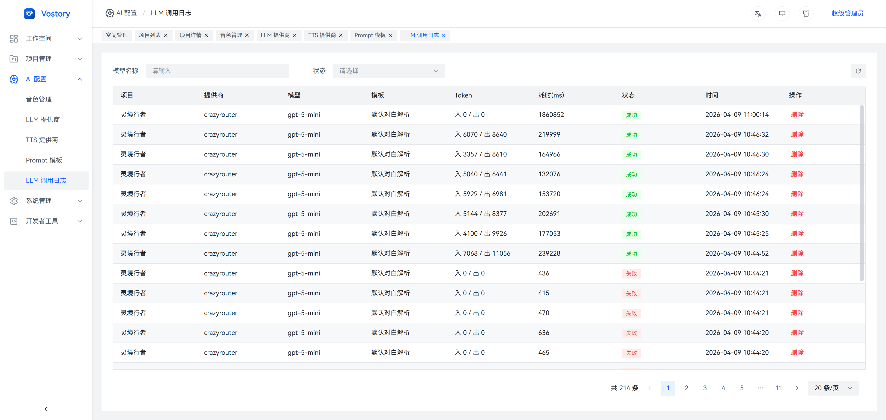

### Docker 一键部署启动

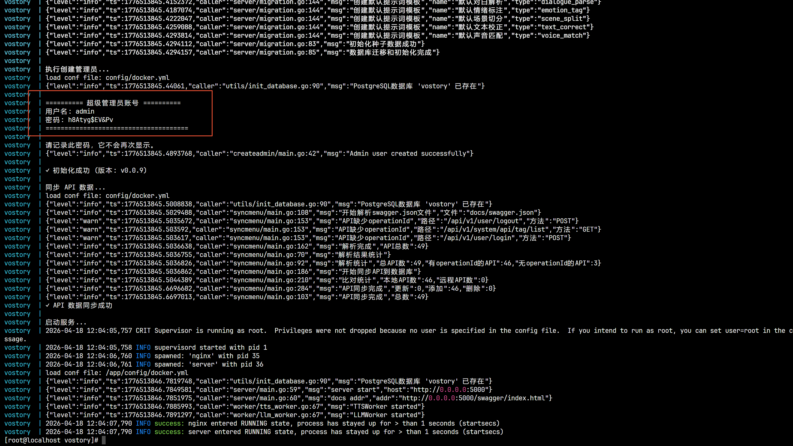

## 核心功能

### 小说导入与结构化

- 支持 `txt` / `docx` / `epub` 格式导入
- 自动按章节切分内容
- 自动将段落切分为脚本片段（旁白 / 对白 / 内心独白）
- 长文分批处理，支持断点续跑与单批次重试

### 角色抽取与管理

- LLM 自动抽取角色候选，识别别名与称呼
- 切分时注入已知角色表，称呼自动还原为标准名
- 角色合并（迁移台词与别名）、泛称角色（老者、店小二、众人等）一键归入路人池
- 层级分类（主角 / 配角 / 龙套）、自动归属台词说话人
- 情绪类型 + 情绪强度 + 演绎指令标注

### 声音资产管理

- **全局声音资产库**（`VoiceAsset`）：跨项目复用的音色资源
- **项目声音配置**（`VoiceProfile`）：角色的基础音色（参考音频 + 逐字转写 + 固定种子）
- **音色设计**：LLM 撰写音色描述 → Breeze-TTS-2 Voice Design 生成参考音频，可逐个试听或批量一键生成
- 可选的多情绪参考音频（开心 / 悲伤 / 愤怒等）
- 参考音频上传、试听、替换

### 脚本编辑

- 片段级浏览与编辑
- 修正说话人归属、片段类型、情绪标签与强度、演绎指令
- 发音词典管理（项目级 + 全局级，以同音字替换纠正读音）
- 精准填充：LLM 输出自动对齐回原文，确保不丢字不加字

### 批量语音生成

- 按章节批量生成音频
- 基础音色 + 演绎指令（Voice Direction），指令为空时按情绪 + 强度兜底
- 单片段试听与重生成
- 异步任务队列，支持排队、重试、超时、取消与恢复
- SSE 实时推送生成进度

### 导出交付

- 章节音频拼接导出
- 段落间停顿、角色切换停顿插入
- 音量标准化
- 支持 `wav` / `mp3` 格式导出

### 系统管理

- RBAC 权限控制
- 工作区管理
- 操作审计日志
- LLM 调用日志审计

## 技术架构

```
┌─────────────────────────────────────────────────────┐
│                    Web 前端                          │
│          Vue 3 + TypeScript + Arco Design           │
│                                                     │
│  项目管理 │ 脚本编辑 │ 角色管理 │ 任务监控 │ 导出    │
├───────────────────────┬─────────────────────────────┤
│      REST API         │          SSE                │
│   (业务 CRUD)         │   (任务进度实时推送)         │
├───────────────────────┴─────────────────────────────┤
│                 业务服务层 (Go)                       │
│                                                     │
│  认证权限 │ 项目章节 │ 脚本片段 │ 角色资产            │
│  任务调度 │ 文件管理 │ AI 配置 │ 审计日志            │
├──────────────────────┬──────────────────────────────┤
│   AI 服务层           │       存储层                 │
│                      │                              │
│  LLM 适配层          │   PostgreSQL (业务数据)       │
│    ├ OpenAI          │   Redis (缓存/任务队列)       │
│    ├ DeepSeek        │   MinIO/S3 (音频/文件)        │
│    ├ Anthropic       │                              │
│    ├ Gemini          │                              │
│    ├ Ollama          │                              │
│    ├ Azure OpenAI    │                              │
│    ├ 阿里云百炼       │                              │
│    └ 自定义兼容接口   │                              │
│                      │                              │
│  TTS 引擎            │                              │
│    └ Breeze-TTS-2    │                              │
│      (GPU 自部署)     │                              │
└──────────────────────┴──────────────────────────────┘
```

### 前端 — `vostory-web/`

| 技术 | 说明 |
|------|------|
| Vue 3 + TypeScript | 核心框架 |
| Vite | 构建工具 |
| Arco Design Vue | UI 组件库 |
| Pinia | 状态管理 |
| Vue Router 4 | 路由（模块化拆分：AI / 工作区 / 项目 / 系统） |
| vue-i18n | 国际化 |
| Monaco Editor | 代码/文本编辑器 |
| ECharts | 数据可视化 |
| COS SDK | 对象存储上传 |
| Tailwind CSS + Less | 样式方案 |

### 后端 — `vostory-server/`

| 技术 | 说明 |
|------|------|
| Go (Gin) | Web 框架 |
| GORM | ORM，支持 PostgreSQL / MySQL / SQLite |
| Google Wire | 依赖注入 |
| JWT | 认证（HS256） |
| Redis | 缓存、任务队列（List）、SSE 事件通道（Pub/Sub） |
| Swagger (swag) | API 文档自动生成 |
| Zap | 结构化日志 |
| Viper | 配置管理（YAML） |

### 数据存储

| 组件 | 用途 |
|------|------|
| PostgreSQL | 业务关系数据、脚本数据、声音资产元数据 |
| Redis | 缓存、任务队列、SSE 事件发布 |
| MinIO / S3 | 音频文件、参考音频、导出文件 |

## 核心领域模型

| 对象 | 说明 |
|------|------|
| `Workspace` | 工作空间（项目分组） |
| `Project` | 一本书或一个制作项目 |
| `Chapter` | 章节 |
| `ScriptSegment` | 脚本片段（旁白/对白/独白），含情绪类型和强度 |
| `Character` | 项目内角色，支持别名、层级 |
| `VoiceProfile` | 声音配置，绑定角色与音色，支持多情绪参考音频 |
| `VoiceAsset` | 全局可复用声音资产 |
| `PronunciationDictionary` | 发音词典（项目级 + 全局级） |
| `GenerationTask` | 生成任务（文本解析 / TTS 生成） |
| `ExportJob` | 章节导出任务 |
| `LLMProvider` | LLM 服务商配置 |
| `TTSProvider` | TTS 服务商配置 |
| `PromptTemplate` | Prompt 模板，支持多类型与版本管理 |

## 项目结构

```
vostory/
├── docs/                          # 产品与架构文档
├── vostory-server/                # Go 后端服务
│   ├── cmd/
│   │   ├── server/                # HTTP 服务入口
│   │   ├── task/                  # 独立 Worker 进程
│   │   ├── migration/             # 数据库迁移
│   │   ├── syncmenu/              # 菜单同步
│   │   └── createadmin/           # 创建管理员
│   ├── config/                    # 配置文件 (dev/prod/local.yml)
│   ├── internal/
│   │   ├── handler/               # HTTP Handler
│   │   ├── service/               # 业务逻辑层
│   │   ├── repository/            # 数据访问层
│   │   ├── model/                 # 数据模型
│   │   ├── server/                # 服务器初始化与路由
│   │   ├── middleware/            # 中间件 (JWT/RBAC/日志)
│   │   ├── tts/                   # TTS 客户端
│   │   └── worker/                # 异步 Worker (LLM/TTS)
│   ├── pkg/                       # 公共包 (JWT/日志/工具)
│   └── deploy/                    # 部署配置 (Dockerfile/docker-compose)
└── vostory-web/                   # Vue 3 前端
    ├── src/
    │   ├── views/                 # 页面视图
    │   │   ├── ai/                # AI 配置 (LLM/TTS/Prompt/音色)
    │   │   ├── workspace/         # 工作区管理
    │   │   ├── project/           # 项目管理与详情
    │   │   └── system/            # 系统管理
    │   ├── config/
    │   │   ├── router/            # 路由配置 (模块化)
    │   │   ├── apis/              # API 接口封装
    │   │   └── pinia/             # 状态管理
    │   └── packages/              # 内部封装 (请求/工具)
    └── public/
```

## 快速开始

### 环境要求

- Go 1.24+
- Node.js 18+
- PostgreSQL 14+
- Redis 6+

### 后端启动

```bash
cd vostory-server

# 复制并修改配置文件
cp config/dev.yml config/local.yml
# 编辑 local.yml 配置数据库、Redis 等连接信息

# 数据库迁移
go run cmd/migration/main.go -conf config/local.yml

# 同步菜单
go run cmd/syncmenu/main.go -conf config/local.yml

# 创建管理员
go run cmd/createadmin/main.go -conf config/local.yml

# 启动服务
go run cmd/server/main.go -conf config/local.yml
```

### 前端启动

```bash
cd vostory-web

# 安装依赖
npm install

# 启动开发服务器
npm run dev
```

### Docker 部署

```bash
cd vostory-server/deploy/docker-compose

# 启动基础设施 (PostgreSQL + Redis)
docker-compose up -d
```

## AI 服务集成

### LLM 提供商

通过 Provider 策略模式支持多厂商，运行时可切换，无需重启：

- OpenAI / Azure OpenAI
- DeepSeek（OpenAI 兼容）
- Anthropic Claude
- Google Gemini
- Ollama（本地部署）
- 阿里云百炼
- 自定义 OpenAI 兼容接口

### TTS 引擎

语音合成基于 **Breeze-TTS-2**，使用 [han3sui/breeze-tts](https://github.com/han3sui/breeze-tts) 发布的镜像 `han3sui/breeze-tts` 部署（上游 fork，增加了 Bearer 鉴权与 `/status` 系统负载接口，模型权重首次启动时下载）。

**RunPod**：新建模板，镜像填 `han3sui/breeze-tts:latest`，Network Volume 挂载到 `/workspace`，暴露 HTTP 端口 `7860`，环境变量设置 `API_KEY`；API 地址为 `https://<pod-id>-7860.proxy.runpod.net`。

**本地 / GPU 服务器**：

```bash
git clone https://github.com/han3sui/breeze-tts
cd breeze-tts/deploy
cp .env.example .env   # 修改 API_KEY
docker compose up -d
```

运行后在「AI 配置 > TTS 供应商」中填写 API 地址和 API 密钥（与 `API_KEY` 相同），点击「测试」验证连通。

VoStory 用到 Breeze-TTS-2 的三种模式：

- **Voice Design**：LLM 根据角色信息写音色描述，按描述生成参考音频，保存为角色的基础音色
- **Voice Direction**：保持角色的基础音色，按每句的演绎指令（切分时由 LLM 结合场景生成）调整语气、语速和情绪
- **Voice Clone**：无演绎指令的片段按参考音色原样克隆

硬件：普通推理约 8GB 显存，建议 12GB 以上。

> Breeze-TTS-2 的开放权重与自部署产出仅限研究与非商业用途，本项目仅供个人使用。

详见 [docs/tts-integration.md](docs/tts-integration.md)。

## 生产流程

```
导入小说 → 自动分章 → LLM 结构化脚本（含演绎指令）→ 合并角色 / 归入路人池
    → 自动设计音色 → 批量 TTS 生成 → 人工修正 → 局部重生成 → 导出章节音频
```

## License

Private
