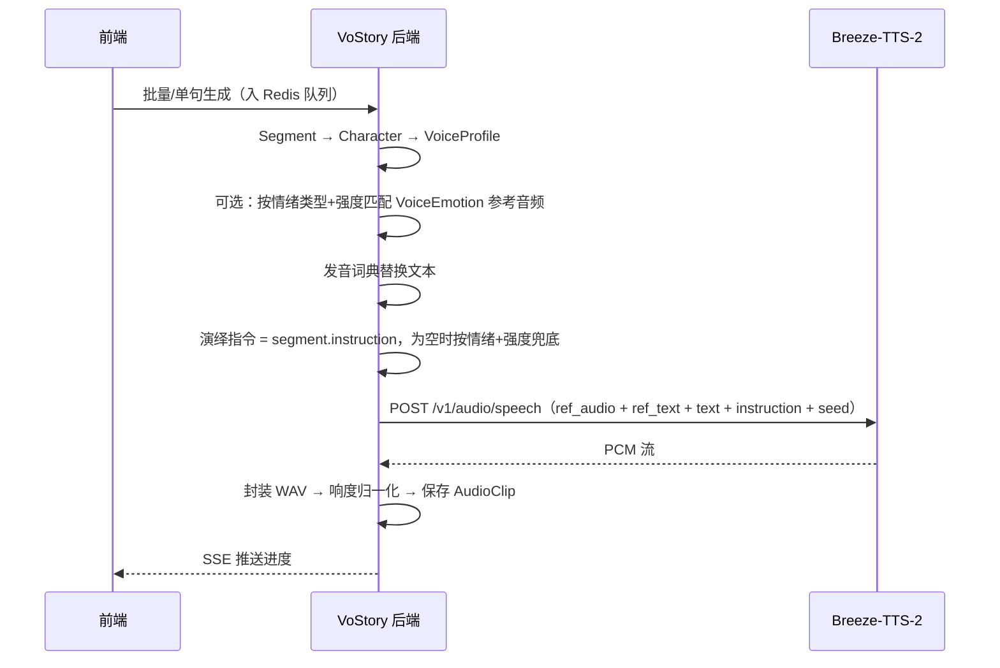

# Breeze-TTS-2 对接实现文档

## 概述

VoStory 通过 HTTP 协议对接自部署的 Breeze-TTS-2 服务，实现三件事：

- **音色设计（Voice Design）**：LLM 根据角色信息写音色描述，Breeze 按描述生成参考音频，保存为角色的基础音色
- **按场景演绎（Voice Direction）**：保持角色的基础音色，按每个片段的演绎指令调整语气、语速和情绪
- **发音纠正**：合成前用发音词典把易读错的词替换为同音字

在"AI 配置 > TTS 提供商"中配置 Breeze-TTS-2 服务地址，并在项目设置中选择该提供商即可使用。

> 许可说明：Breeze-TTS-2 的开放权重与自部署产出仅限研究与非商业用途。本项目仅供个人使用。

---

## Breeze-TTS-2 HTTP 协议

| 方法 | 端点 | 请求 | 响应 |
|------|------|------|------|
| POST | `/v1/audio/speech` | multipart 表单，见下表 | 24kHz 单声道 16bit 小端 PCM 流 |
| GET | `/v1/model` | - | 模型信息（`model_digest`、`frame_rate`、`max_new_tokens` 等），用于连通性测试 |

`/v1/audio/speech` 表单字段：

| 字段 | 说明 |
|------|------|
| `text` | 要合成的文本，可包含 `[笑]`、`[叹气]`、`[咳嗽]` 等中文声音事件标签 |
| `ref_audio` | 参考音频文件（克隆 / 导演模式） |
| `ref_text` | 参考音频的**逐字转写**，与 `ref_audio` 同时提供 |
| `instruction` | 自然语言指令：音色设计时是音色描述，导演模式下是演绎指令 |
| `cfg_scale` | 指令遵循强度，官方建议 4；仅在有 `instruction` 时传入 |
| `seed` | 随机种子 |

三种模式由字段组合决定：

| 模式 | 字段 | VoStory 用途 |
|------|------|-------------|
| Voice Clone | `ref_audio` + `ref_text` + `text` | 演绎指令为空的片段（平静/自动情绪） |
| Voice Direction | `ref_audio` + `ref_text` + `text` + `instruction` | 带演绎指令的片段 |
| Voice Design | `text` + `instruction` | 为角色生成基础音色 |

客户端实现在 `vostory-server/internal/tts/client.go`：`Speech` 发起合成并把 PCM 封装为 WAV，`TestConnection` 调用 `/v1/model`。

---

## 片段合成流程



`VsTTSSynthesizeService.SynthesizeSegment` 的步骤：

1. **查片段 / 角色 / 声音配置**，角色未绑定声音配置时报错
2. **选择参考音频**：命中 `VoiceEmotion`（且有参考文本）时用情绪参考音频，否则用声音配置的基础音色
3. **校验参考文本**：Breeze 克隆需要参考音频的逐字转写，缺失时报错
4. **发音词典替换**：把词替换为词典里的"替换读法"（同音字）
5. **演绎指令**：`segment.instruction` 优先；为空时按下表兜底
6. **固定种子**：`tts_params.seed`（音色设计时记录），否则用声音配置 ID，保证同一角色各句音色稳定
7. **合成并保存**：对象 Key `audio/{chapterID}/{segmentID}_v{version}.wav`（local 落在 `storage/` 下，oss 写入对象存储），标记旧版本为非当前

### 情绪 → 兜底演绎指令

| 情绪 | light | medium | strong |
|------|-------|--------|--------|
| happy | 语气轻快，略带笑意 | 语气愉快，带着笑意 | 非常开心，语调上扬，充满兴奋 |
| sad | 语气略显低落 | 语气悲伤，语速稍慢 | 极度悲伤，带着哭腔，声音哽咽 |
| angry | 语气不满，略带怒意 | 语气愤怒，语速加快 | 暴怒，大声呵斥 |
| fear | 语气有些不安 | 语气紧张害怕，声音发颤 | 极度恐惧，声音颤抖急促 |
| surprise | 语气略带惊讶 | 语气惊讶 | 非常震惊，脱口而出 |
| disgust | 语气略带嫌弃 | 语气厌恶 | 极度厌恶，语带鄙夷 |

`neutral` 与 `auto` 不下发指令，按参考音色原样克隆，由模型根据文本把握语气。

---

## 演绎指令的生成

章节切分（`dialogue_parse` 模板）时，LLM 已经拿到整章文本和场景划分，因此由它顺带为每个片段输出 `instruction`：

- 一句不超过 20 字的中文，描述语气、语速、音量、停顿，例如"压低声音，急促地"、"冷笑着，慢条斯理"
- 不描述音色和性别（音色由参考音频决定）
- 平铺直叙的旁白可为空

后端截断到 40 字后存入 `vs_script_segment.instruction`。旧的自定义切分模板没有 `instruction` 字段时，后端会在 prompt 末尾自动追加这条要求。

脚本编辑器中每个片段都有「演绎」输入框，可以直接改写后重新生成。

---

## 音色设计

| 方法 | 路径 | 权限 ID | 说明 |
|------|------|---------|------|
| POST | `/api/v1/character/:id/voice-design/suggest` | `character:voice_design` | LLM 根据角色信息和台词，生成音色描述与参考台词 |
| POST | `/api/v1/character/:id/voice-design/preview` | `character:voice_design_preview` | Voice Design 生成试听，返回 WAV（base64）、种子和试听文件路径 |
| POST | `/api/v1/character/:id/voice-design/apply` | `character:voice_design_apply` | 把试听保存为声音配置（参考音频 + 参考台词 + 种子）并绑定角色 |
| POST | `/api/v1/character/:id/voice-design/auto` | `character:voice_design_auto` | 以上三步一次完成，用于批量生成 |

- 音色描述的 prompt 模板类型为 `voice_design`，可在"AI 配置 > Prompt 模板"中修改
- 参考台词既是试听文本，也是保存后的 `reference_text`（Voice Design 生成的音频与这句台词逐字对应）
- 试听对象 Key 为 `reference-audio/voice-design/preview_*.wav`，保存时复制到 `reference-audio/{timestamp}_{name}_design.wav`；local 模式下未保存的试听 24 小时后清理
- 保存的声音配置 `tts_params` 中记录 `seed` 与 `voice_design`（音色描述），`description` 也写入音色描述，供"匹配已有声音"使用

前端入口：

- 角色列表每行「设计音色」：AI 撰写描述 → 生成试听（可反复换）→ 保存并绑定
- 工具栏「配置声音」→「自动生成音色」：为未绑定声音的角色批量一键生成，可按主角/配角/路人池/其他龙套筛选
- 工具栏「配置声音」→「匹配已有声音」：LLM 把角色匹配到项目里已有的声音配置

---

## 部署说明

### Breeze-TTS-2 服务

使用 [han3sui/breeze-tts](https://github.com/han3sui/breeze-tts)（上游 fork，`deploy/` 下增加了部署包装）发布的镜像 `han3sui/breeze-tts`：

- **Bearer 鉴权**：设置 `API_KEY` 后，除 `/health` 外的接口都需要 `Authorization: Bearer <API_KEY>`
- **`/status`**：CPU / 内存 / GPU 负载，对应 TTS 提供商页的「系统负载」列
- **权重不在镜像里**：首次启动按 `MODEL_ID`（默认 `BreezeBlue/Breeze-TTS-2`）下载到 `HF_HOME`（`/workspace/hf-cache`）

**RunPod**（不支持 docker-compose，用模板部署）：

| 模板项 | 值 |
|--------|----|
| Container Image | `han3sui/breeze-tts:latest` |
| Volume Mount Path | `/workspace`（挂 Network Volume，模型只下载一次） |
| Expose HTTP Ports | `7860` |
| 环境变量 | `API_KEY`=随机串；`FAST_ALL`=`true`（16GB 以下显卡填 `false`）；需要时 `HF_TOKEN` |

API 地址为 `https://<pod-id>-7860.proxy.runpod.net`。

**本地 / 普通 GPU 服务器**：

```bash
git clone https://github.com/han3sui/breeze-tts
cd breeze-tts/deploy
cp .env.example .env   # 修改 API_KEY
docker compose up -d
```

- 普通推理约 7.7GB 显存，建议 12GB 以上；`FAST_ALL=true` 约 14.4GB，建议 24GB
- 服务是单并发的，TTS 提供商的"最大并发数"保持 1；服务繁忙（409）时后端会等待重试，最长 3 分钟

完整说明见 breeze-tts 仓库的 `deploy/README.md`。

### 配置 TTS 提供商

"AI 配置 > TTS 提供商"：

- **API 地址**：RunPod 填 `https://<pod-id>-7860.proxy.runpod.net`，本地填 `http://<GPU 机器 IP>:7860`
- **API 密钥**：与部署时的 `API_KEY` 相同，后端以 `Authorization: Bearer` 发送
- **最大并发数**：1
- 点击「测试」会调用 `/v1/model` 并显示模型摘要；「查看状态」显示 GPU 负载

### 配置声音

1. 项目设置中选择 TTS 提供商和 LLM 提供商
2. 角色管理 →「配置声音」→「自动生成音色」，或逐个「设计音色」
3. 也可以手动在"声音配置"中上传参考音频，**必须填写参考音频的逐字转写**
4. 在脚本编辑器中调整演绎指令，点击「生成」试听
